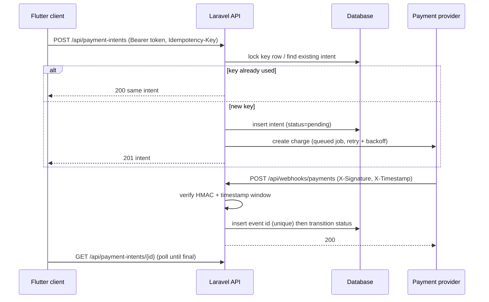

# laravel-flutter-payments-patterns

[](https://github.com/AbdouShalby/laravel-flutter-payments-patterns/actions/workflows/ci.yml)

Generic, original reference patterns for safe payments in a Laravel API with a Flutter client. Not extracted from any real product; all names are illustrative.

## Patterns
- Token auth (Laravel Sanctum personal access tokens).
- Payment intents created with an `Idempotency-Key` header: a retried request returns the same intent, never a second charge.
- Webhook signature verification (HMAC-SHA256 over `timestamp.payload`, constant-time compare, 5-minute replay window).
- Idempotent webhook processing (unique provider event id) and a state machine that only moves forward.
- Retries with exponential backoff for provider calls (queued job), and client-side retries that reuse the same key.

## Architecture


## Status machine
`pending -> processing -> succeeded | failed`. Transitions backwards or out of a final state are ignored, so duplicate or out-of-order webhooks are harmless.

## Layout
- `api/`: the Laravel pieces (routes, controllers, middleware, models, service, job, migrations, feature tests). Drop into a fresh `laravel new` app with Sanctum installed.
- `client/`: minimal Dart sketch showing token header, idempotency key reuse and retry with backoff.
- `scripts/bootstrap-test-app.sh`: reproducible test setup (used by CI).
- `docs/decisions.md`: why each choice was made.

## Running tests
```
./scripts/bootstrap-test-app.sh /tmp/payments-app
```
Creates a fresh Laravel 12 app, installs Sanctum (`php artisan install:api`), adds `HasApiTokens` to `User`, copies `api/` in, migrates SQLite and runs `php artisan test` (8 pattern tests). CI runs the same script. Set `PAYMENTS_WEBHOOK_SECRET` in `.env` for real use.

## License
MIT
